# Siege Mind

[](https://github.com/ItsTheDemiGod/siege-mind/actions/workflows/ci.yml)
[](LICENSE)

Siege Mind is a browser tower defense game in which the enemy side is an adaptive Director AI: after every wave it measures which enemy types did well against your towers and tilts the next wave toward them, while spending exactly the same threat and enemy HP as the fixed script. A live overlay shows each enemy type's weight and why it changed, so the game explains its own difficulty adjustment. Behind the game sits a headless, seeded experiment harness that played bot defenses against six enemy modes under a pre-registered protocol.

Live demo: <!-- LIVE_URL -->(not deployed yet)<!-- /LIVE_URL -->

## Screenshots

| | |
|---|---|
| 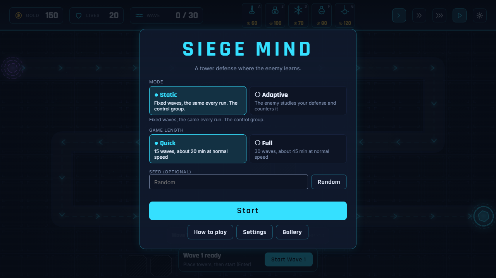 | 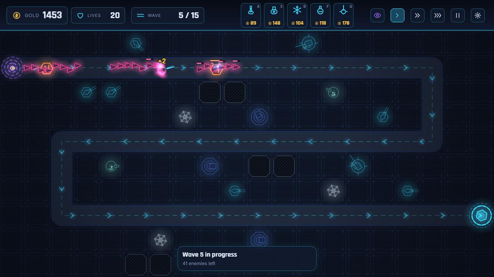 |
| 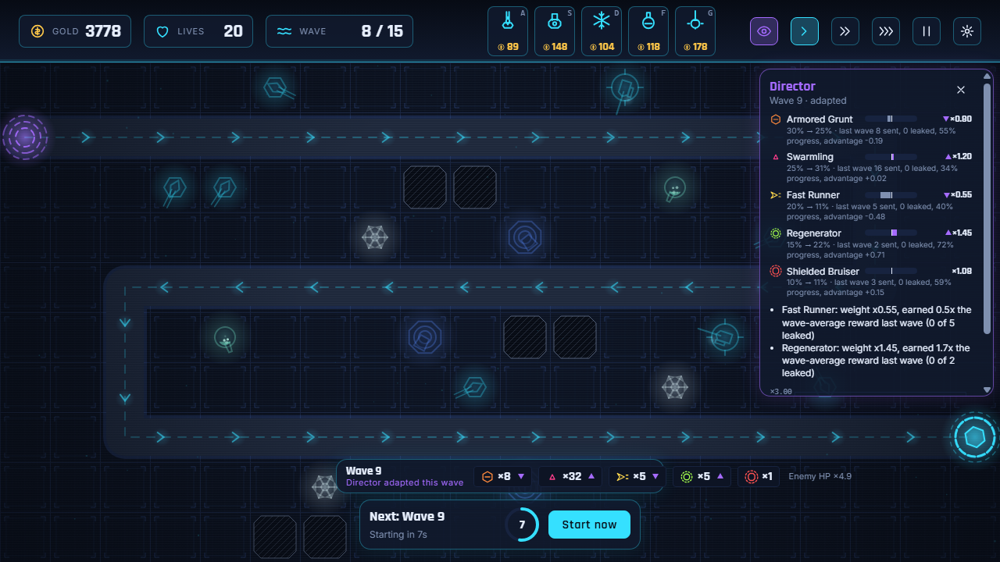 | 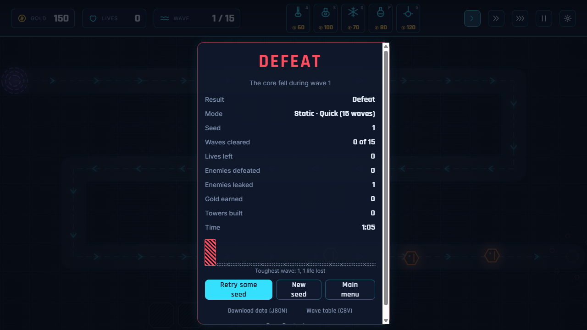 |
| 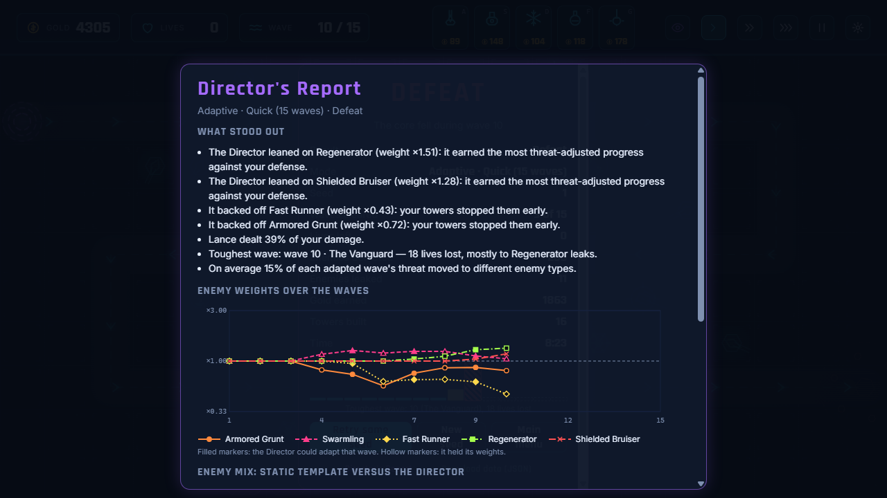 | 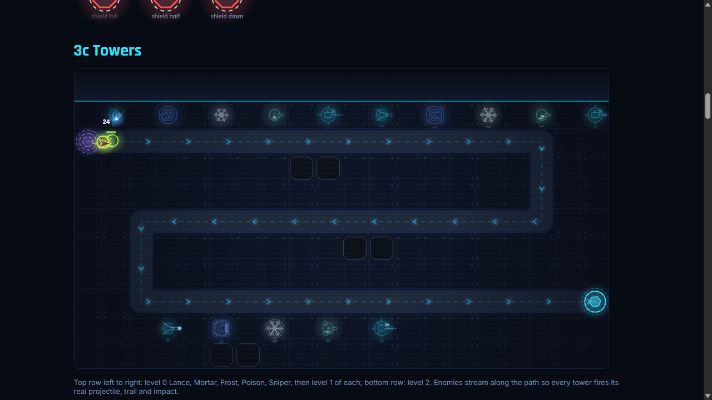 |
| 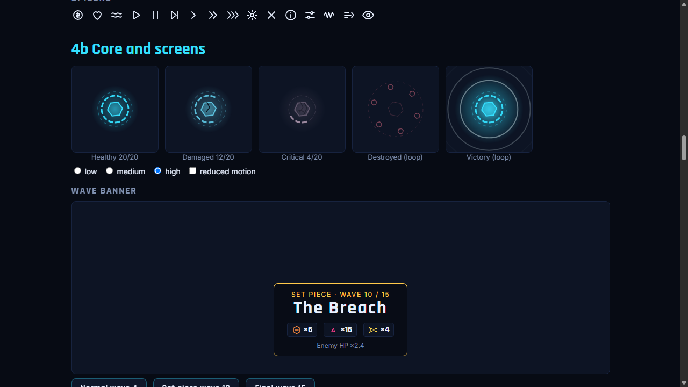 | 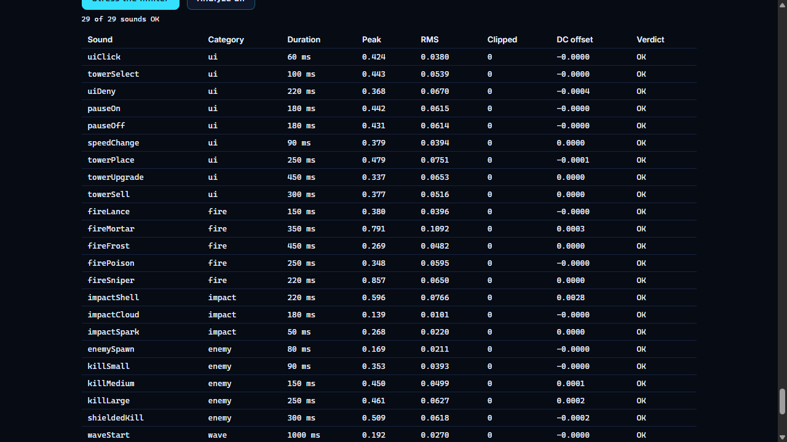 |
| 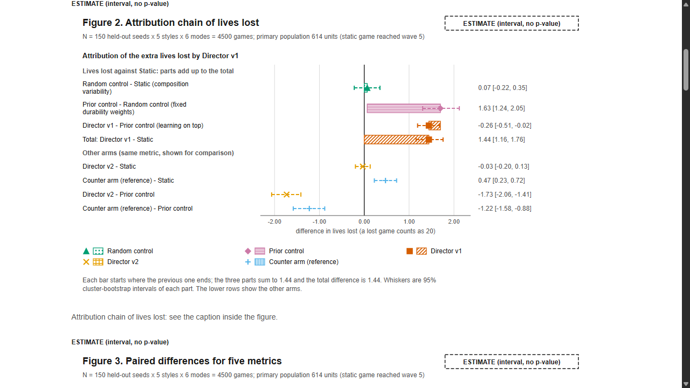 | 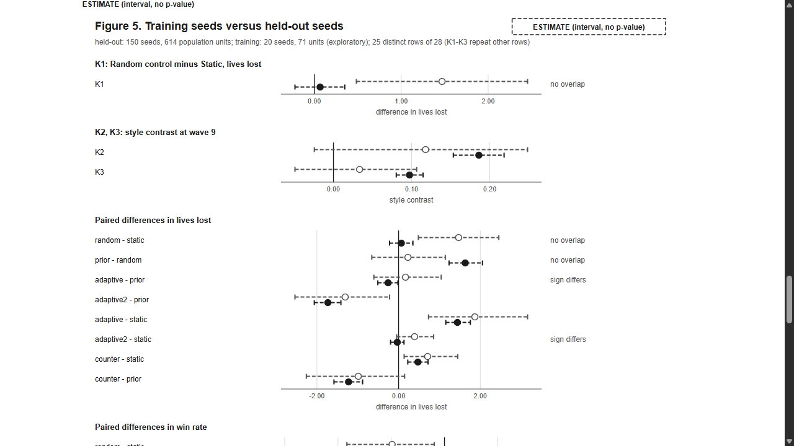 |

The screenshots are produced by `npm run shots` from a headless Chrome (software rendering, no GPU).

## Features

- Five towers (Lance, Mortar, Frost, Poison, Sniper) with two upgrade levels, three targeting modes and clear counter relationships to five enemy types (Armored Grunt, Swarmling, Fast Runner, Regenerator, Shielded Bruiser).
- A fixed winding map, a Quick game of 15 waves and a Full game of 30 waves, with set pieces and a threat budget that grows by a documented curve.
- Six enemy modes behind one simulation: Static, Adaptive (Director v1), the random control and three research arms (Director v2, a prior control, an informed counter arm).
- Explainability: the Director overlay (key `I`), direction marks in the wave banner and preview, and the Director's Report after the game.
- Fully procedural presentation: canvas art with pooled particles and quality tiers, a Web Audio synthesizer for every sound, hand-built SVG charts. No image or audio files.
- Accessibility work: keyboard-only building with a tile cursor, focus traps in every dialog, reduced-motion support and an audit tool (`npm run audit`).
- Telemetry and a reproducible experiment pipeline: every run can be exported as JSON and CSV.

## How to play

Open the game, pick **Quick** or **Full**, optionally type a seed, and press **Start**. Stop the enemies reaching your base: build towers, click a tower to upgrade or sell it, start waves, and keep an eye on the incoming-wave preview.

| Key | Action |
|---|---|
| `A` `S` `D` `F` `G` | Arm Lance, Mortar, Frost, Poison, Sniper (or click a tower in the tray at the top) |
| Click a free tile | Build the armed tower; `Esc` or right click stops placing |
| Arrow keys | While a tower is armed: move the placement cursor to the next buildable tile |
| `Enter` | Place at the cursor after you moved it; otherwise start the wave (also right after a placement) |
| `[` / `]` | Select the previous / next tower |
| `U` | Upgrade the selected tower |
| `Delete` / `Backspace` | Sell the selected tower (most of the gold comes back) |
| `1` / `2` / `3` | Game speed |
| `Space` | Pause / resume |
| `Esc` | Cancel placing or deselect, otherwise open the pause menu |
| `I` | Director overlay (Adaptive and the research arms) |
| `M` | Mute / unmute the sound |
| `N` | Single step (while paused) |
| `` ` `` (backquote) | Toggle the debug panel |

Four short first-run hints explain the basics in your first game (**Got it** dismisses one, **Skip all hints** turns them off, **Reset hints** in Settings brings them back). The gear button in the HUD opens Settings: quality, automatic quality lowering, screen shake, reduced motion, particle density, sound and volumes.

## Game modes

- **Static**: fixed, hand-authored waves, the same every run. The control group.
- **Adaptive**: the Director (v1) tilts the mix of eligible waves toward the enemy types that got furthest against your defense. Every wave spends the same threat and enemy HP as Static; waves one to four, six, eight and the set pieces stay as written.
- **Random control** (`mode=random`, URL only): tilts waves at random by the same amount and learns nothing.
- **Research arms** (URL only, not in the menu): `mode=adaptive2` (Director v2), `mode=prior` (fixed weights from the static baseline, no learning) and `mode=counter` (reads the tower loadout; a reference, not a fair competitor).
- A game is set up by its URL: `?seed=<integer or text>&mode=static|adaptive|random|adaptive2|prior|counter&waves=15|30&play=1`. Without `play` or `debug` the menu opens first. How the Director works: [docs/DIRECTOR.md](docs/DIRECTOR.md).

## Run locally

Node 22 or newer is needed for the dev server, the tests and the experiments (nothing else; there are no npm dependencies).

```
npm start      # or: npm run dev
```

Then open `http://localhost:8137`. To use another port, set `PORT`:

```
# PowerShell
$env:PORT=9000; npm start
# cmd
set PORT=9000 && npm start
# bash
PORT=9000 npm start
```

The style gallery is at `/gallery.html`. Add `?seed=<integer or text>` to replay a specific seed.

## The research in one paragraph

The question was whether an adaptive enemy that re-weights waves from what it observes really responds to the player's defense, and how much of its extra difficulty comes from learning rather than from side effects. A pre-registered protocol (amendments A1 to A3, a held-out seed set and a lock that allows exactly one confirmatory run) compared six modes against scripted bot defenses. The confirmatory results: both Directors' weights separate defenses in the predicted direction, while composition variability alone had no detectable effect on lives lost. Most of Director v1's added difficulty is reproduced by a fixed, non-learning lean toward durable enemy types, and Director v2 is not detectably harder than the static script. The study used bots on one map and says nothing about how humans experience the game. Read [docs/RESULTS.md](docs/RESULTS.md) for the numbers, [docs/PROJECT_REPORT.md](docs/PROJECT_REPORT.md) for the whole story and [docs/EXPERIMENT.md](docs/EXPERIMENT.md) for the pre-registration.

## Architecture

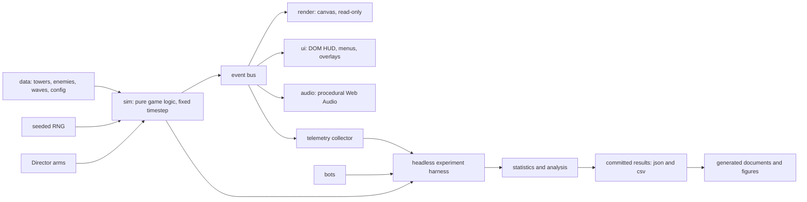

The simulation in `src/sim` has no access to the DOM, the clock or `Math.random`; it advances in fixed steps, draws all randomness from a seeded generator and announces what happens on an event bus. Rendering, UI, audio and telemetry only subscribe to those events and read state, which is why the same code runs unchanged in the browser and in Node for the experiments.

| Folder | What it holds |
|---|---|
| `src/sim` | Pure game logic: map, enemies, towers, projectiles, waves, economy, the Director arms, telemetry |
| `src/data` | Every tower, enemy, wave and economy number, plus the generated Director baseline |
| `src/render` | Canvas drawing: layers, entities, particles, glow sprites, quality tiers |
| `src/ui` | DOM interface: HUD, menus, banner, overlay, report, settings, hints, keyboard cursor |
| `src/audio` | The procedural sound catalogue, event mapper, voice limiter and engine |
| `assets` | Favicon and the vendored fonts |
| `experiments` | Bots, the batch runner, statistics, the pre-registered protocol, analysis and the generators of results and figures |
| `docs` | Hand-written and generated documentation, committed results, fixtures and screenshots |
| `tests` | The `node --test` suite, including golden files and the freeze tripwire |
| `tools` | Dev tools: headless-Chrome checks, screenshots, the hygiene scanner, the report builder |
| `scripts` | The dev server, the site build and the live-URL helper |

## Tests and the freeze

`npm test` runs the whole suite on Node's built-in test runner. Golden files pin the output of every mode, a balance ladder pins the difficulty shape, and `tests/study-freeze.test.js` fails if anything under `src/sim` or `src/data` changes: the held-out study describes exactly that simulation, so a change to the game would define a new version outside the study. CI runs the tests, the site build and the hygiene scan on every push.

## Site build

`npm run build:site` writes the static site into `dist/` (the pages, `src`, the assets, the gallery fixture and the final figures; nothing else), which is what `vercel.json` publishes. `npm run smoke:dist` loads every page of that build in a headless Chrome, and `npm run smoke:live -- --base=<url>` does the same against a deployed URL. The deployed build keeps the `debug` URL parameters because they are a research tool and harmless for visitors.

After deploying, record the address here with `npm run set-live-url -- --url=https://your-site.example`.

## Reproducibility

- `npm test`: the full suite. `npm run playthrough -- --bot=balanced --seed=1 --waves=15 --mode=static` replays a whole game headlessly (modes `static`, `adaptive`, `random`).
- `npm run experiment`, `npm run analyze`, `npm run confirm`, `npm run results-doc`, `npm run figures:final` and `npm run report-doc` regenerate the study outputs from the committed data. The held-out set is protected by `experiments/heldout.lock.json`: it refuses to run again.
- Every result file records the protocol hash and the code hash, and every generated document is produced by a script with tests.

## Developer notes

### Debug tools (need `?debug=1`)

`?debug=1` unlocks the following and also exposes `window.__siege` (game, telemetry, `step`, `startWave`) for tools. `?gold=<n>` sets the starting gold, `?wave=<n>` the first wave, `?startlives=<n>` the lives, `?spawn=<n>` the old random spawner and `?stress=1` forty towers with a spawn every few ticks.

- Spawn one enemy: `Q` grunt, `W` swarmling pack, `E` fast runner, `R` regenerator, `T` bruiser, `Y` one of each, `K` nukes everything.
- Click tools: `Z` direct, `X` piercing, `C` sniper, `V` poison, `B` frost, `M` splash; a click on an enemy applies the selected tool.

### Run data

Every game records what happened (observation only). The end screen offers **Download data (JSON)** and **Wave table (CSV)**, and `npm run playthrough -- --bot=balanced --seed=1 --waves=15 --telemetry=full` writes the same tables headlessly; `npm run summarize -- <file>` prints them. Schema: [docs/TELEMETRY.md](docs/TELEMETRY.md).

### Browser checks (dev)

These drive a local headless Chrome, Chromium or Edge over the DevTools protocol with Node built-ins only (set `CHROME_PATH` if it is not found); they are not part of `npm test`.

- `npm run smoke:browser` loads the menu, games, the gallery and the stress mode and checks each page; screenshots go to `tools/browser-check/out/` (git-ignored).
- `npm run browser-check -- --url=/?seed=1&play=1 --wait=3000 --shot=game.png` loads one page and exits non-zero on any console error.
- `npm run audit` writes [docs/AUDIT.md](docs/AUDIT.md) (names, roles, focus, contrast, overflow, reduced motion, frame times).
- `npm run hygiene` scans the tracked files for personal paths, e-mail addresses, tokens and oversized files.

### Experiments and balance tools

- `npm run matchups` prints the tower-versus-enemy matchup table; `npm run compare -- --bots=weak,monoMortar,monoSniper,balanced --modes=static,adaptive,random --seeds=1,2,3 --waves=15` plays all combinations headlessly and prints comparison tables.
- `npm run calibrate` chooses the style bots' knobs (static mode only), `npm run plan-heldout` prints the confirmatory plan, and `npm run experiment -- --set=tuning` plays the exploratory tuning games into `docs/results/`. The pre-registration is [docs/EXPERIMENT.md](docs/EXPERIMENT.md).
- Waves pay a clear bonus and prices grow with the number of towers owned; the numbers live in `src/data/config.js` and the difficulty ladder is asserted by `tests/balance.test.js`.

### Sound

All sounds are generated live from oscillators and filtered noise; the browser starts audio after your first click or key press. The Sound lab in the style gallery plays every sound and analyzes each one offline. No human has listened to them yet, so treat loudness balance as unverified.

## Credits and license

Built phase by phase with Claude Code; every decision, known issue and session is logged in [CLAUDE.md](CLAUDE.md). The code is released under the [MIT license](LICENSE). The fonts (Rajdhani and Inter) are under the SIL Open Font License; see [THIRD_PARTY.md](THIRD_PARTY.md).
