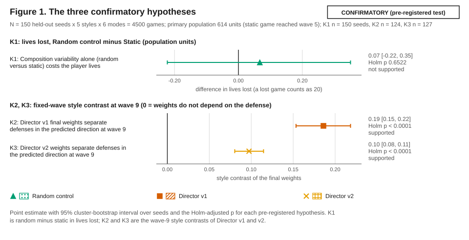
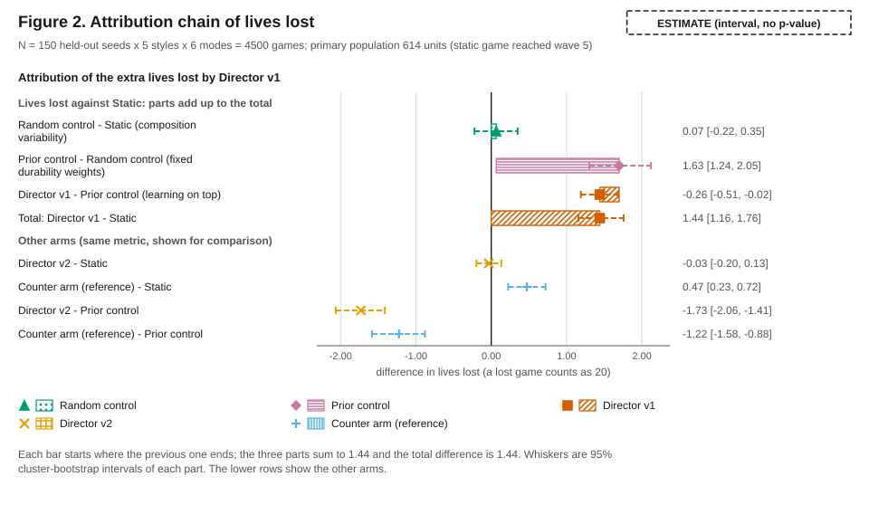
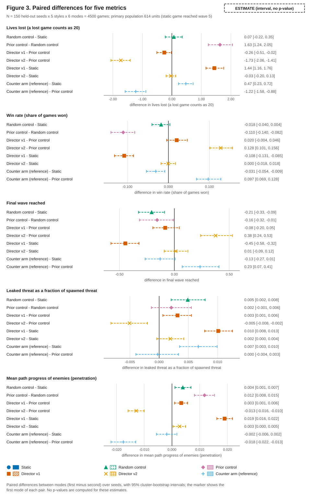
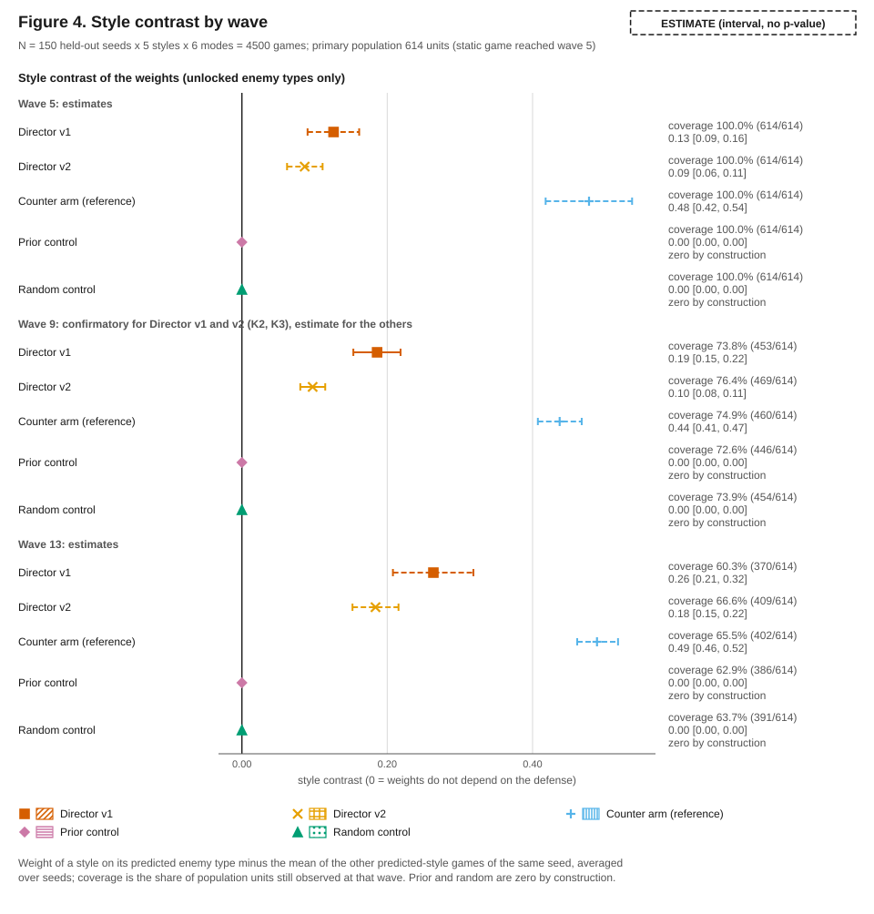
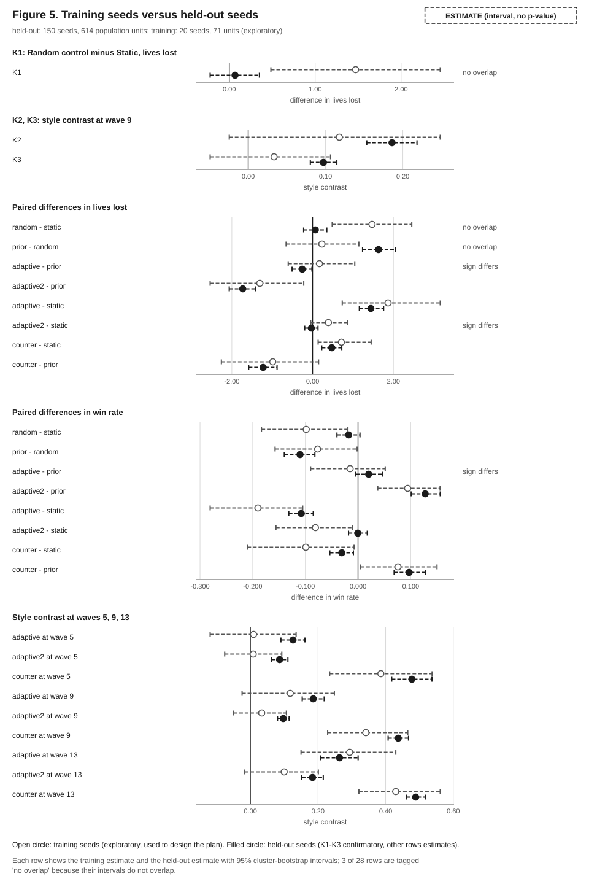
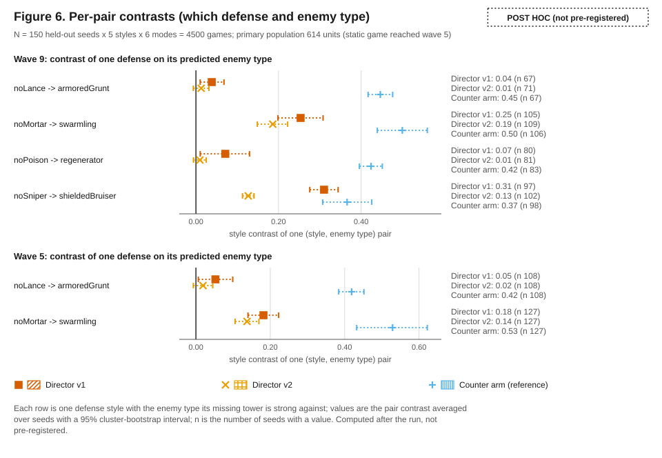

# Siege Mind: project report

*Generated by `tools/docs/buildReport.js` from `docs/report/*.md` and `docs/RESULTS.md`. Do not edit by hand; run `npm run report-doc`.*

## Contents

1. [Overview](#1-overview)
2. [The game](#2-the-game)
3. [Architecture](#3-architecture)
4. [Engineering practice](#4-engineering-practice)
5. [Research question and method](#5-research-question-and-method)
6. [Results](#6-results)
7. [Limits and future work](#7-limits-and-future-work)
8. [How to run and reproduce](#8-how-to-run-and-reproduce)
9. [Appendix](#9-appendix)

## 1. Overview

Siege Mind is a browser-based tower defense game with a twist: the enemy side is controlled by an adaptive Director AI (`CLAUDE.md`, Project Summary). After every wave the Director measures which enemy types did well against the player's current tower loadout and re-weights the next wave toward them, while the total wave difficulty stays identical to the fixed script, so only the composition changes, never the raw difficulty (`CLAUDE.md`, Project Summary; `docs/DIRECTOR.md`). A live panel shows each enemy type's weight and why it changed, so a viewer can see why the waves shifted (`docs/DIRECTOR.md`, Reading the overlay).

The project is a solo game development class project with two goals: a polished, fully playable game, and a clear technical story about adaptive difficulty, player modeling and explainable game AI (`CLAUDE.md`, Project Summary). This report tells both stories. The game is described in the Game section, the way it is built in the Architecture and Engineering sections, and the research that was done with it in the Method section and the Results section.

### Goals

The project defines its own definition of done (`CLAUDE.md`, Success Criteria):

- the game is fully playable from the main menu to a win or lose screen, without crashes, at a smooth frame rate on a normal laptop;
- five tower types, five enemy types and thirty waves, with counter relationships that are felt in play;
- a mode toggle between Static and Adaptive in the menu;
- an Adaptive Director that measurably changes wave composition in response to the player's loadout, visible in the overlay;
- a headless experiment harness that compares the modes across several bot strategies and many seeds, reproducibly;
- a public deployment with a README, a demo script and report material;
- visual consistency (every entity, effect and interface element follows one visual design bible, with no placeholder shapes after the visual foundation phase) and a Low quality mode for weak machines;
- engineering quality: tests pass in CI on every push, headless experiments are reproducible from a seed, and the README carries screenshots and an architecture diagram.

### Where the project stands

The game, the Director arms, the telemetry layer, the experiment harness, the pre-registered held-out evaluation, the procedural audio, the accessibility pass, the static site build, the CI workflow and the documentation are implemented (`CLAUDE.md`, Phase Tracker). Several things have deliberately not been done or could not be verified, and the Limits section lists them: no human has played the game in a structured test, no human has listened to the sounds, performance was measured only without a GPU, and the deployment itself is a step for the owner of the repository (`CLAUDE.md`, Known Issues).

### How to read this report

This document is generated by `npm run report-doc` from hand-written section files in `docs/report/` and from the results document `docs/RESULTS.md`. The Results section embeds the headline, the confirmatory results, the limits and the non-claims of that document word for word, so every number in this report comes from one generated source. The hand-written sections state no study numbers; they point to the generated documents instead.

## 2. The game

### The map and the rules

There is one fixed, winding map on a tile grid with a single entry and a single base, drawn as a dark holographic tactical table; towers are placed only on buildable tiles beside the path, and a few decor tiles are blocked (`CLAUDE.md`, Game Design Spec). The player starts with some gold and a number of lives; kills and cleared waves pay gold, upgrades and selling are allowed, and tower prices grow with the number of towers owned, with a cap on the total (`CLAUDE.md`, Game Design Spec; Decisions Log, difficulty rework). A leaking enemy costs lives, and losing all lives ends the game (`CLAUDE.md`, Game Design Spec).

A game is a Quick game of 15 waves (the default) or a Full game of 30 waves. Both use the same wave script, hit point curve and economy; Quick simply ends after wave 15 (`CLAUDE.md`, Game length). A game is fully described by its URL: seed, mode, game length and whether to skip the menu (`CLAUDE.md`, Menu and URL flow; `README.md`).

### Towers

Five towers, each with two upgrade levels and three targeting modes, and each strong against one enemy type and weak against another (`CLAUDE.md`, Towers):

| Tower | Role | Strong against | Weak against |
|---|---|---|---|
| Lance | homing, armor-piercing bolt | Armored Grunt | Swarmling |
| Mortar | ballistic shell with splash damage | Swarmling | Fast Runner and tanky single enemies |
| Frost | pulse that slows everything in range | Fast Runner; supports every tower | low standalone damage |
| Poison | bolt that poisons a small area and stops regeneration | Regenerator | Fast Runner, Shielded Bruiser |
| Sniper | instant, armor-piercing shot with bonus damage against shields | Shielded Bruiser | Swarmling, Fast Runner |

The counter relationships were checked by a headless matchup harness and tests, not only by feel (`CLAUDE.md`, Phase Tracker, tower logic; Decisions Log, matchup relations).

### Enemies

Five enemy types, each identifiable by silhouette and color (`CLAUDE.md`, Enemies and Visual Design Bible):

- **Armored Grunt**: a hexagon with flat armor.
- **Swarmling**: small triangles that arrive in packs.
- **Fast Runner**: an elongated chevron that is much faster than the rest.
- **Regenerator**: a circle with a pulsing ring that heals unless poisoned and costs extra lives when it leaks.
- **Shielded Bruiser**: a large octagon whose shield must break first, which also blocks damage over time, and which costs extra lives when it leaks.

### Waves

Every wave has a threat budget that follows a fixed curve, and the static script builds each wave from a hand-authored template of threat shares; enemy hit points and shields scale with the wave number while armor, speed, rewards and threat costs stay flat (`CLAUDE.md`, Waves). The opening waves introduce the enemy types one by one, three waves are fixed set pieces (wave 10 'The Vanguard', wave 20 'Tide of Swarm', wave 30 'The Siege'), and the waves in between rotate themes (`CLAUDE.md`, Waves).

### The six modes

All modes spend the same threat per wave and apply the same enemy hit points; only the composition of eligible waves differs (`docs/EXPERIMENT.md`, Research question; `docs/DIRECTOR.md`).

- **Static**: the hand-authored waves, the control group.
- **Adaptive** (Director v1): after every finished wave it scores each enemy type by how far it got against the defense, per unit of threat, and tilts the next eligible wave toward the types that scored well (`docs/DIRECTOR.md`, Observation and Composition).
- **Random control**: tilts waves at random by the same amount and learns nothing, so results can be compared against waves that are merely different (`docs/DIRECTOR.md`, Random control).
- **Director v2** (research arm): divides each type's reward by what that type usually earns in static games, and shrinks the estimate for types with few units (`docs/DIRECTOR.md`, Director v2).
- **Prior control** (research arm): fixed weights taken from the static baseline alone, with no learning and no look at the defense (`docs/DIRECTOR.md`, Prior control).
- **Counter arm** (research arm): reads the tower loadout directly; it is a reference for what a Director with that knowledge could do, not a fair competitor (`docs/DIRECTOR.md`, Informed counter arm).

The menu offers Static and Adaptive; the other modes are reachable only through the URL (`README.md`, Game modes).

### Explaining the Director

The Director overlay (key `I`) shows, for the upcoming wave, each enemy type's template share, final share, weight and the evidence behind it, in plain language and with a small chart; direction marks in the wave banner and preview show which types were raised or lowered, and the end screen offers a Director's Report with insights, a weight chart and the enemy mix against the static template (`docs/DIRECTOR.md`, Reading the overlay and The Director's Report). The insight texts are descriptive rather than causal on purpose (`CLAUDE.md`, Decisions Log, explainability).

### Presentation

All visuals are procedural: canvas drawing with pooled particles, glow sprites and quality tiers, DOM and CSS for text, hand-built SVG for icons and charts (`CLAUDE.md`, Tech Stack and Visual Design Bible). Every sound is generated live with the Web Audio API from oscillators and filtered noise, with a voice limiter, volume and mute settings and a Sound lab that analyzes each sound offline (`CLAUDE.md`, Decisions Log, procedural audio). First-run hints, a keyboard tile cursor and reduced-motion support round out accessibility (`CLAUDE.md`, Decisions Log, hints and keyboard cursor; `docs/AUDIT.md`).

## 3. Architecture

The code is vanilla JavaScript with ES modules, the HTML canvas element and no framework, no bundler and no runtime dependencies; Node is used only for development tooling, tests and headless simulation (`CLAUDE.md`, Tech Stack and Hard Constraints; `THIRD_PARTY.md`). Eight architecture rules were fixed at the start and every change to them had to be logged (`CLAUDE.md`, Architecture Rules).

### Rules that shape everything

1. **Sim and render are separate.** Everything in `src/sim` is pure game logic with no reference to the window, the document, a canvas or any DOM API, so it runs unchanged in Node; `src/render` and `src/ui` read state and never mutate it. A test enforces the purity (`tests/sim-purity.test.js`; `CLAUDE.md`, Decisions Log, simulation purity).
2. **Fixed timestep.** The simulation advances in fixed steps. Game speed means more steps per rendered frame, never a larger step, and a frame-time clamp prevents a spiral of death (`CLAUDE.md`, Architecture Rules and Decisions Log, stepper).
3. **Seeded randomness.** All simulation randomness goes through one seeded generator with independent forked streams, so the Director's randomness does not shift when combat code consumes more numbers (`CLAUDE.md`, Decisions Log, RNG).
4. **Data-driven design.** Every tower, enemy, wave and economy number lives in `src/data`.
5. **Event bus.** The simulation emits events (wave started and ended, enemy spawned, killed or leaked, tower placed or fired, game over); telemetry, audio, particles and the interface subscribe instead of being called from simulation code (`CLAUDE.md`, Architecture Rules).
6. **Serializable state.** Game state is plain objects and arrays, so runs can be logged, snapshotted and compared.
7. **Small modules.** One responsibility per file, around three hundred lines at most.
8. **Render performance rules.** No per-frame allocation in hot paths, pooled particles and projectiles, cached glow sprites instead of shadow blur, a cached static background, a pixel-ratio-aware canvas and interpolation between simulation steps (`CLAUDE.md`, Architecture Rules).

### Layers

```text
data  ->  sim (pure, fixed timestep, seeded RNG)  ->  event bus  ->  render | ui | audio | telemetry
                       |
                       +-->  headless experiments: bots, batch runner, statistics  ->  results  ->  generated documents and figures
```

- `src/sim` holds the map, enemies, towers, projectiles, waves, the economy, lives, statistics and the Director arms. The Director math uses only basic arithmetic, comparisons and a few Math functions, and avoids power, exponential and logarithm functions so that every JavaScript engine gives the same numbers (`CLAUDE.md`, Director AI Spec, Numeric rules; Decisions Log, Director).
- `src/render` draws the canvas: a cached static layer, animated path flow, entities, additive effects and overlays (`CLAUDE.md`, Visual Design Bible, Rendering).
- `src/ui` is the DOM and CSS interface, driven by CSS variables that mirror the render theme; a test keeps the two in sync (`CLAUDE.md`, Decisions Log, theme parity). Pure view models (for example the Director overlay, the end screen, the keyboard cursor and the hint placement) are separated from the DOM code so they can be tested without a browser.
- `src/audio` is a procedural synthesizer driven only by simulation events, inert until the first user gesture (`CLAUDE.md`, Decisions Log, procedural audio).

### Reuse for experiments

Because the simulation is pure, the experiment harness imports the same modules the browser uses: scripted bots act only through simulation commands, the batch runner plays whole games headlessly and the same game reaches the same result from the same seed (`CLAUDE.md`, Decisions Log, style bots; Experiment Harness Spec). The Director is independent of telemetry, and telemetry is observation only: it copies primitives out of events, never writes game state and never uses a clock or a random number, which a test proves by comparing snapshots with and without it (`CLAUDE.md`, Telemetry Spec and Decisions Log, telemetry; `docs/TELEMETRY.md`).

### Telemetry

A run exports as one self-describing JSON object (configuration and definitions included) and four CSV tables (waves, wave by enemy type, enemies, towers); a validator checks the consistency of a run, and a documentation test checks every column (`docs/TELEMETRY.md`). Each wave also carries the Director's decision record, which is what the overlay and the report read (`docs/DIRECTOR.md`, The decision record).

### Deployment shape

The deployed site is a static build: a script copies the pages, the whole `src` tree (the browser imports the simulation and data modules too), the assets, the gallery fixture and the final figures into a `dist` folder and writes a manifest of sizes and hashes; nothing else ships (`scripts/build-site.js`; `README.md`, Site build). The build is described in the Engineering section.

## 4. Engineering practice

### Tests

The whole suite runs on Node's built-in test runner with a single command (`CLAUDE.md`, Coding Conventions; `README.md`, Tests and the freeze). Beyond unit tests of the simulation modules it contains:

- **Determinism tests**: the same seed and the same bot give identical results (`CLAUDE.md`, Coding Conventions).
- **Golden files**: the static waves and their threat were generated before the wave composer was refactored and are never regenerated, which proves the refactor left Static bit for bit unchanged; later goldens pin the director payloads and results of every mode, so changing one mode cannot silently change another (`CLAUDE.md`, Decisions Log, Director and goldens).
- **A balance ladder**: bots of increasing strength must lose at increasingly late waves, which guards the shape of the difficulty rather than a single win or lose number (`CLAUDE.md`, Decisions Log, difficulty rework), and a calibration guard that fails when the balance changes in a way that requires recalibrating the experiment bots (`docs/EXPERIMENT.md`, Players).
- **Parity and rule tests**: the style sheet must mirror the render theme, z-index values must be tokens, and render rule tests search the drawing code for forbidden techniques such as shadow blur (`CLAUDE.md`, Decisions Log, theme parity and z-index tokens; Folder Structure, tests).
- **Documentation tests**: the telemetry documentation must mention every column, superseded statements must carry a pointer to the held-out result, and the generated documents guard their own wording (see below) (`docs/TELEMETRY.md`; `CLAUDE.md`, Decisions Log, results document).

### The freeze tripwire

After the held-out evaluation the simulation and data folders were frozen: a test hashes them and fails on any change, and checks that the held-out lock belongs to the current protocol. A change to the game therefore defines a new version outside the study and requires updating the pinned hash on purpose (`tests/study-freeze.test.js`; `CLAUDE.md`, Phase Tracker, study freeze). Work after the freeze touched only interface, rendering, audio, documentation and deployment.

### Generated documents with guards

The results document, the figures and this report are produced by scripts. No number is typed by hand in a generated document. The results generator throws if the confirmatory outcome differs from the outcome its fixed sentences describe, and every claim in those sentences is checked against named thresholds, so a different result cannot silently produce stale text (`CLAUDE.md`, Decisions Log, results document; `docs/RESULTS.md`). The same rule applies to hand-written documents: they use words and file pointers instead of numbers that exist in generated outputs (`CLAUDE.md`, Decisions Log, results package).

### Accessibility and performance audit

An audit tool drives a headless Chrome through the main screens and applies pure rules: accessible names and roles, dialogs and focus traps, focus rings, text contrast, overflow at several window sizes, reduced motion and frame times in the stress mode; its output is the generated `docs/AUDIT.md`. It is a practical subset, not a full WCAG audit, and entries drawn over the canvas are listed as unresolved rather than passed (`docs/AUDIT.md`; `CLAUDE.md`, Decisions Log, audit). It found and led to fixes for a muted text color below the contrast limit on a selected menu option and duplicate SVG pattern ids in the Director legend (`CLAUDE.md`, Decisions Log, audit). Frame times were measured with software rendering only; a real GPU was not measured (`CLAUDE.md`, Known Issues).

### Browser checks and screenshots

Dev tools drive a local headless Chrome over the DevTools protocol using only Node built-ins: a smoke check loads every page and exercises key flows (keyboard building, the hint card position, the Sound lab analysis, stress mode), and a screenshot tool produces the README images and validates their size and byte range (`README.md`, Browser checks; `tools/browser-check`). These tools are not part of the test suite because they need a browser.

### Continuous integration and the static site build

A GitHub Actions workflow runs on every push to the main branch and on pull requests: it checks out the full history and tags, installs Node, runs the tests, builds the static site and runs the hygiene scan (`.github/workflows/ci.yml`). The site build copies only what the browser needs, writes a deterministic manifest and refuses to clean any folder other than its own output; tests check that every script, stylesheet, module import and font reachable from the two pages exists with the exact letter case, because a case-insensitive development machine would hide errors that a Linux server shows (`scripts/build-site.js`, `tests/siteBuild.test.js`). The workflow could not be executed locally; it is covered by structure tests only (`CLAUDE.md`, Known Issues).

### Public repository hygiene

The repository is public. A scanner reads the tracked files and reports personal home paths, e-mail addresses, access tokens and key patterns, tracked environment files and oversized files; an allowlist may name only frozen or generated study files, each with a reason, and the tests reject an allowlist entry for any editable file (`tools/hygiene`; `CLAUDE.md`, Decisions Log, public repository). The code is released under the MIT license and the two vendored font families under the SIL Open Font License (`LICENSE`, `THIRD_PARTY.md`).

### Working protocol

The project was built phase by phase with Claude Code. Each phase began by reading the project brain file, worked only on the current phase, ended with the tests, an update of the phase tracker, the decision log, the known issues and the session log, and a commit and tag; the next phase began only when the user said so (`CLAUDE.md`, Working Protocol and Session Log).

## 5. Research question and method

### The question

Does an enemy director that adapts the composition of waves to a player's defense make the game harder than the same waves in a fixed script, and is that effect more than "different waves"? (`docs/EXPERIMENT.md`, Research question.) The study grew over time: the first questions concerned Director v1, and later phases added arms that split its effect into parts.

### Fairness

In every mode each wave spends the same threat, enemies get the same hit point multiplier and a game has the same number of waves; only the composition of eligible waves differs. Eligible waves exclude the fixed set pieces, the introduction waves and the first waves; the Director still learns from every finished wave (`docs/EXPERIMENT.md`, Research question; `CLAUDE.md`, Director AI Spec). These invariants are tested.

### The Director in one paragraph

For each enemy type that spawned in a wave, the Director computes a reward from how far the units got, with leaks counting as full progress, relative to their threat cost. It compares each type with the threat-weighted average, smooths that advantage into a running score, and turns the score into a bounded weight (tilt) that multiplies the type's template share before the shares are renormalized and turned into a wave that spends the target threat (`CLAUDE.md`, Director AI Spec; `docs/DIRECTOR.md`). A known bias, flagged before any experiment, is that durable types tend to travel further against most defenses and so score higher, which is why the control arms exist (`CLAUDE.md`, Director AI Spec, Known bias).

### The players

Scripted bots act only through simulation commands and draw their choices from their own seeded stream. Since amendment A2 the experiment uses ablation styles: one balanced random mix and styles that each omit one tower, so that a defense lacking a tower should be weak against exactly the enemy type that tower counters; this gives every style a prediction read from the tower data rather than guessed (`docs/EXPERIMENT.md`, Players). The bots were calibrated in static mode only, before any adaptive result was looked at, and the calibration dropped one style whose static games were almost never won (`docs/EXPERIMENT.md`, Players).

### Seed sets

Calibration seeds were used only for bot knobs. The tuning seeds were exploratory and split into training and validation parts. The held-out seeds were disjoint from every other set and run once (`docs/EXPERIMENT.md`, Seed sets). Seeds are the clusters of the analysis: games of one seed share their random choices, so comparisons are paired at the seed level, with cluster bootstrap intervals and sign-flip permutation tests, and with Holm adjustment inside a family (`docs/EXPERIMENT.md`, Analysis plan).

### Pre-registration, amendments and the incident

The protocol was written before any held-out data existed, and its hash is stored in every result file and in the held-out lock (`docs/EXPERIMENT.md`, opening paragraph).

- **A1** moved the measurement of the final weights to the last eligible wave for adaptive and random alike, after a measurement asymmetry was noticed in the tuning results; no hypothesis, metric or seed set changed.
- **A2** replaced the focus styles with the ablation styles, retired a hypothesis that was biased in favor of the random control by construction, and added a contrast statistic, a sensitivity analysis and an early-ends check.
- **A3** is the pre-registration of the single held-out evaluation: six modes, a primary population of units whose static game reached wave 5, a fixed wave for the style contrast (wave 9, chosen although a coverage rule fixed earlier was not met on the training data, with the reason stated in advance), three confirmatory hypotheses K1, K2 and K3 with Holm adjustment, estimands reported with intervals and no p-values, sensitivity analyses, an interpretation guide written before the results and a no-tuning rule (`docs/EXPERIMENT.md`, Amendments and Amendment A3).

Each amendment states its chronology: what had been seen when it was made. An incident is also on record: the validation split was once run without a lock before the lock was wired into the command line tool; the outputs were deleted unread, so the validation seeds are not pristine and were not used for confirmation (`docs/EXPERIMENT.md`, Incident log).

### The attribution chain

To split the total effect of Director v1 into parts, two non-learning arms were added: the random control (composition variability) and the prior control (a fixed lean toward durable enemy types, with no learning and no look at the defense). The chain is exact, checked unit by unit: the effect of v1 against static equals the effect of random against static, plus the effect of the prior against random, plus the effect of v1 against the prior (`docs/EXPERIMENT.md`, Amendment A3, Estimands; `CLAUDE.md`, Decisions Log, prior control). It follows one path through the arms; a different path would split the total differently (`docs/RESULTS.md`, Limits).

### What was confirmatory and what was an estimate

Only K1, K2 and K3 are tests. K1 asks whether composition variability alone costs lives; K2 and K3 ask whether the final weights of Director v1 and Director v2 separate defenses in the predicted direction at wave 9. Everything else (the attribution parts, contrasts at other waves, other metrics, per-pair results, the replication check against the training seeds) is reported as an estimate with an interval and no p-value, and the post hoc parts are labelled as such (`docs/EXPERIMENT.md`, Amendment A3; `CLAUDE.md`, Decisions Log, confirmatory plan).

### The lock and the freeze

The held-out procedure is fixed: a clean working tree, a plan printout, one run through a lock that is written before any game is played and records the git commit and the protocol hash, then the analysis command, which refuses rows that do not match the lock and never computes statistics on incomplete data (`docs/EXPERIMENT.md`, The held-out procedure). Afterward the simulation was frozen by a test. The outcome in words is in the Results section.

## 6. Results

This section embeds, word for word, four sections of the generated results document ([RESULTS.md](RESULTS.md)); every number in this report comes from there.

### Headline

- Both Directors respond to the player's defense, mainly through two of the four counter relationships. At wave 9 the weights of Director v1 separate defenses in the predicted direction (contrast 0.19, 95% CI [0.15, 0.22], Holm p < 0.0001) and so do those of Director v2 (0.10, [0.08, 0.11], Holm p < 0.0001). Both confirmatory hypotheses were supported. By pairing (post hoc): noMortar -> swarmling 0.25 [0.20, 0.31] for Director v1 and 0.19 [0.15, 0.22] for Director v2; noSniper -> shieldedBruiser 0.31 [0.28, 0.34] for Director v1 and 0.13 [0.11, 0.14] for Director v2; noPoison -> regenerator 0.07 [0.01, 0.13] for Director v1 and 0.01 [-0.01, 0.02] for Director v2; noLance -> armoredGrunt 0.04 [0.01, 0.07] for Director v1 and 0.01 [-0.01, 0.03] for Director v2. The informed counter arm, a reference, separates defenses on all four pairings (0.37 to 0.50; overall 0.44).
- Random composition alone had no detectable effect on lives lost. K1 (random minus static, lives lost) was 0.07 ([-0.22, 0.35]) and was not supported. That is not proof of no effect: random composition did lower the final wave reached slightly (random minus static -0.21 [-0.33, -0.09] waves, an estimate outside the confirmatory family). The training seeds had suggested 1.47 ([0.48, 2.45]) for lives lost; that estimate did not replicate.
- A fixed, non-learning lean toward durable enemy types reproduces most of Director v1's added difficulty. Of v1's 1.44 extra lives lost against static, an attribution along the path static, random control, prior control, Director v1 assigns 0.07 to composition variability, 1.63 to the durability bias (the prior control: fixed weights from static baselines, no learning, no look at the defense) and -0.26 to learning on top; the last is small and its sign is not consistent across metrics (see the estimates).
- Director v2 removes that bias: its lives lost and win rate are not detectably different from static (lives lost -0.03 [-0.20, 0.13], win rate 0.000 [-0.018, 0.018]) while its weights still separate defenses (K3).

### Confirmatory results

| ID | Hypothesis | Seeds | Estimate | 95% CI | Holm p | Supported |
| --- | --- | --- | --- | --- | --- | --- |
| K1 | Composition variability alone (random versus static) costs the player lives | 150 | 0.07 | [-0.22, 0.35] | 0.6522 | no |
| K2 | Director v1 final weights separate defenses in the predicted direction at wave 9 | 124 | 0.19 | [0.15, 0.22] | < 0.0001 | yes |
| K3 | Director v2 weights separate defenses in the predicted direction at wave 9 | 127 | 0.10 | [0.08, 0.11] | < 0.0001 | yes |

Only these three hypotheses are tests. The primary population is the 614 units whose static game reached wave 5; wave 9 was fixed in advance although its coverage (72.6%) was below the registered 75% rule.

### Limits

- The players are scripted bots on one map; the bots were calibrated on static outcomes and pooled over styles.
- Contrasts at waves 9 and 13 are conditional on survival (coverage at wave 9: 72.6% to 76.4%; at wave 13: 60.3% to 66.6%).
- The coverage rule was not met (minimum coverage at wave 9 is 72.6%, the rule asks for 75%); the registered plan kept wave 9.
- Lives lost saturates because a loss counts as 20.
- The counter arm reads the loadout; it is a reference, not a fair competitor.
- The validation seeds (1021-1030) were not used for confirmation because they are not pristine.
- The secondary metrics show small effects of random composition that the confirmatory family does not cover (final wave, random minus static: -0.21 [-0.33, -0.09]; leaked threat fraction: 0.005 [0.002, 0.008]).
- The wave-5 contrast of Director v1 was 0.01 on training data and 0.13 held-out; the per-pair replication table shows where the two differ and the gap was not investigated further.
- The attribution follows one path through the arms (static, random control, prior control, Director v1); the three parts add up exactly, but a different path would split the total differently.

### What this does not show

- That the Director makes the game more enjoyable or better for human players.
- That learning improves difficulty: the learning-on-top estimate is small and mixed in sign.
- That the weights are optimal.
- Anything about human players: none were involved.

### Figures













The full results document, with the estimates, the contrast by wave, the per-pair tables, the replication check and the provenance of the held-out run, is [docs/RESULTS.md](RESULTS.md).

## 7. Limits and future work

### Limits of the study

The results section embeds the generated limits and non-claims of the held-out evaluation. In addition, the pre-registration and the decision log record these structural limits (`docs/EXPERIMENT.md`, Threats to validity and Amendment A3, Limits stated in advance):

- The players are scripted bots with a small family of tower mixes, not humans; the study says nothing about enjoyment or fairness as people experience them.
- There is one map and one enemy set, and the simulation is deterministic, so seeds change only enemy lanes and the bots' random choices.
- The bots were calibrated on static outcomes only, and the styles are pooled in the primary analysis.
- Late-wave contrasts are conditional on surviving to that wave, and the coverage rule for the fixed wave was not met.
- The counter arm reads the loadout and is a reference, not a fair competitor.
- The attribution follows one path through the arms.

### Limits of the product

These are open items recorded in the project's known issues (`CLAUDE.md`, Known Issues):

- No human played a structured playtest; visual checks were made in a headless Chrome with software rendering, so animation feel and real frame rates on a GPU are unverified.
- No human has listened to the procedural sounds; only offline analysis (peak, loudness, offset, leading silence) and engine tests exist. Music was left out on purpose.
- The accessibility audit is a practical subset, and keyboard-only play was smoke-tested for building only.
- The continuous integration workflow and the Mermaid architecture diagram in the README could not be run or rendered locally.
- The deployed build keeps the `debug` URL parameters. They are a research tool and harmless for visitors, but they exist.
- The Director's Report modal sits above the end card without hiding it, so the card shows faintly behind the report.

### Out of scope on purpose

Changing the game after the held-out run defines a new version outside the study. The items below were identified and deliberately not done (`CLAUDE.md`, Phase Tracker, study freeze):

- a late-game gold sink such as a third upgrade tier, because the balanced bot ends long games with a large unspent balance;
- separate early and late slopes of the hit point curve, because lives are only lost in the early and middle waves today;
- a finale wave in the Quick game;
- a balance pass and rebalance from harness data, which would require recalibrating the bots;
- a re-check of one clause of the balance ladder.

### Future work

- Human playtests: do people notice the adaptation, does it feel fair, and does the overlay help them understand it?
- Other maps and enemy sets, to see whether the durability bias and the response to the defense carry over.
- Better Director signals: the reward favors durable enemies against most defenses, and Director v2 shows that normalizing against a static baseline removes the bias at the cost of a milder response.
- A rebalance as a new version with its own tag and, if it is to be studied, its own pre-registration.
- Optional music, final visual tuning and a listening pass on the sounds.

## 8. How to run and reproduce

### Run the game

Node 22 or newer is the only requirement; there are no npm dependencies (`README.md`, Run locally).

```text
npm start          # serves the game at http://localhost:8137 (set PORT to change it)
npm test           # the whole test suite
npm run build:site # writes the static site into dist/
```

A game is set up by its URL: `?seed=<integer or text>&mode=static|adaptive|random|adaptive2|prior|counter&waves=15|30&play=1`. Without `play` or `debug` the menu opens first (`README.md`, Game modes).

### Replay a game headlessly

```text
npm run playthrough -- --bot=balanced --seed=1 --waves=15 --mode=static
npm run playthrough -- --bot=balanced --seed=1 --waves=15 --mode=adaptive
npm run playthrough -- --bot=balanced --seed=1 --waves=15 --mode=random
```

The same seed and bot always give the same result; add `--telemetry=full` to write the run as JSON and CSV and `npm run summarize` to print tables (`README.md`, Run data; `docs/TELEMETRY.md`, How to export).

### Regenerate the study outputs

These commands rebuild the analysis and the documents from the committed data (`docs/EXPERIMENT.md`, Reproduction; `docs/RESULTS.md`, Provenance):

```text
npm run confirm -- --in=docs/results/heldout.rows.json --out=docs/results/heldout-confirmatory
npm run figures:final
npm run results-doc
npm run report-doc
```

The held-out evaluation itself must not be repeated: `experiments/heldout.lock.json` records that it was run, and the command refuses to run again without an explicit new-lock flag, which would be recorded as another run (`docs/EXPERIMENT.md`, The held-out procedure). The exploratory pipeline (`npm run calibrate`, `npm run experiment -- --set=tuning`, `npm run analyze`) is documented in the same place.

### Other checks

```text
npm run smoke:browser   # headless Chrome smoke checks of every page
npm run smoke:dist      # the same checks against the built site
npm run audit           # accessibility and performance audit, writes docs/AUDIT.md
npm run shots           # README screenshots into docs/screens
npm run hygiene         # public-repository scan
```

After deploying, `npm run smoke:live -- --base=<url>` runs the smoke checks against the live address and `npm run set-live-url -- --url=<url>` records the address in the README (`README.md`, Site build).

### Verifying that the study is untouched

The freeze test fails on any change under `src/sim` or `src/data`, the lock must match the protocol hash, and the held-out files carry recorded hashes in the Provenance section of the results document (`docs/RESULTS.md`, Provenance; `tests/study-freeze.test.js`).

## 9. Appendix

### File map

| Path | What it holds |
|---|---|
| `index.html`, `gallery.html` | The game page and the style gallery |
| `src/sim` | Pure simulation: map, enemies, towers, projectiles, waves, economy, lives, statistics, the Director arms, telemetry |
| `src/data` | Every tower, enemy, wave and economy number, configuration, the generated Director baseline |
| `src/render` | Canvas drawing, particles, glow sprites, quality tiers, tower and enemy art |
| `src/ui` | DOM interface and the pure view models behind it |
| `src/audio` | Procedural sound catalogue, event mapper, voice limiter, engine, analysis |
| `assets` | Favicon and the vendored fonts with their license texts |
| `experiments` | Bots, batch runner, protocol, statistics, analysis, generators of results and figures |
| `tests` | The test suite, golden files and the freeze tripwire |
| `tools/browser-check` | Headless Chrome tools: smoke checks, audit, screenshots |
| `tools/hygiene` | The public-repository scanner and its allowlist |
| `tools/docs` | The report builder |
| `scripts` | Dev server, static site build, live-URL helper |
| `docs` | Documentation, committed results, fixtures and screenshots |

(`CLAUDE.md`, Folder Structure; `README.md`, Architecture.)

### Documents

| Document | Kind | Purpose |
|---|---|---|
| `README.md` | hand-written | Entry point: pitch, screenshots, controls, modes, architecture, reproducibility |
| `CLAUDE.md` | hand-written | Project brain: rules, specifications, phase tracker, decision log, known issues, session log |
| `docs/DIRECTOR.md` | hand-written | The Director algorithm, configuration keys, decision record, overlay and report |
| `docs/TELEMETRY.md` | hand-written | Telemetry schema, attribution rules, CSV tables |
| `docs/EXPERIMENT.md` | hand-written | The pre-registered protocol, amendments, incident log, held-out procedure |
| `docs/RESULTS.md` | generated | Results of the held-out evaluation |
| `docs/AUDIT.md` | generated | Accessibility and performance audit |
| `docs/PROJECT_REPORT.md` | generated | This report |
| `docs/DEMO_SCRIPT.md` | hand-written | A six-minute demo plan |
| `docs/results/README.md` | hand-written | Explains every committed result file |

### Frozen and generated files

The held-out rows, tables and confirmatory analysis under `docs/results`, the training first-look files, the lock and the Director baseline are frozen or generated study files and are never edited by hand (`CLAUDE.md`, Working Protocol and Decisions Log; `docs/results/README.md`).

### Glossary

- **Threat budget**: the total threat a wave spends, the same in every mode.
- **Tilt**: the bounded weight by which a mode multiplies an enemy type's template share.
- **Held weights**: the weights the Director believes in, computed from its scores, even on waves where it may not adapt.
- **Eligible wave**: a wave in which the composition may differ from the static script.
- **Style bot**: a scripted defense with a fixed tower mix that omits one tower.
- **Style contrast**: how much more weight a Director gives, at a fixed wave, to the enemy type predicted for a defense than it gives the same type against the other defenses.
- **Attribution chain**: the exact decomposition of Director v1's effect into composition variability, a fixed durability lean and learning on top.
- **Held-out lock**: the file that records the single confirmatory run and the commit and protocol it used.
- **Freeze**: the test that fails if the simulation changes after the study.
